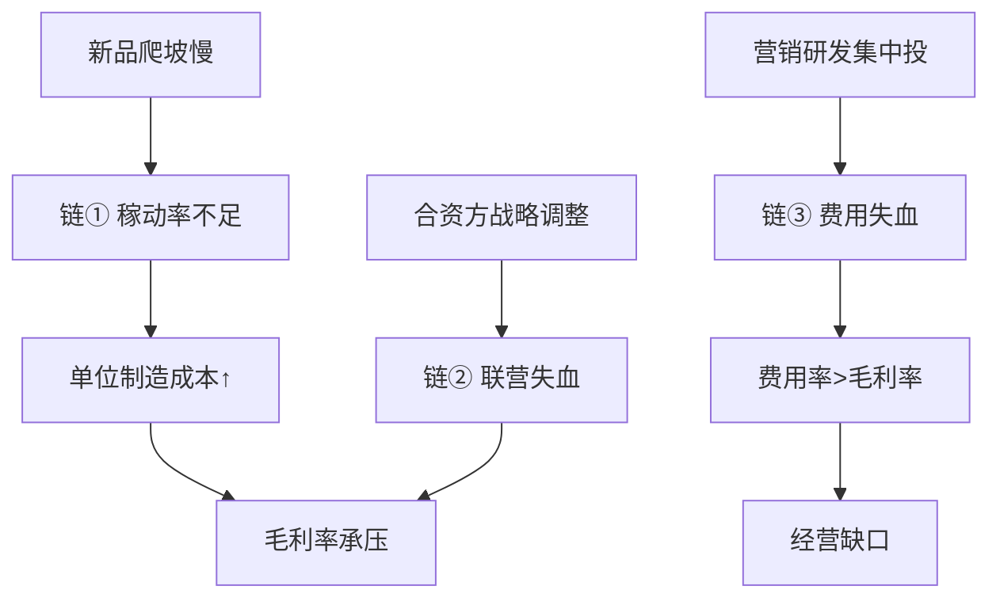

# 参考案例 · 江淮汽车（600418）3D-MG 诊断示例

> **用途**：本文件是「12 模块标准报告格式」的**端到端示例**，演示 3D-MG 怎么把一家公司的公开信息
> 拆成可行动的因果链。它**不是投资报告**，数字均为公开信息整理的方向性示意，凡标
> 「【待核实】」处须以公司正式披露替换后再对外使用。
> 想看完整格式定义，读 `references/report_format.md`。

---

## 一句话结论

不是「车卖得不好」一句话能概括的——是「商用车基本盘在、新能源乘用车仍在失血、
费用率长期高于毛利率」三件事同时发生，必须分三条链路分别治理。

---

## 一、公司画像

| 项 | 内容 |
|---|---|
| 全称 | 安徽江淮汽车集团股份有限公司（600418.SH，上交所主板） |
| 属性 | 地方国有控股 · 商用车 + 乘用车 + 新能源 |
| 主营业务 | 轻卡/重卡等商用车、新能源乘用车（含代工与合资）、零部件 |
| 规模量级 | 年营收数百亿级（具体以年报为准【待核实】） |
| 公开已知结构 | 与大众合资（大众安徽）、曾为蔚来代工，新能源乘用车仍在投入期 |

---

## 二、现状镜像 · 事实层

- 商用车（轻卡等）为基本盘，需求随宏观与基建/物流周期波动。
- 新能源乘用车处于产品迭代与产能爬坡期，单位固定成本受稼动率拖累。
- 扣非净利润曾连续多年为负，经营质量改善滞后于营收增长【待核实具体年度】。

---

## 三、因果镜像 · 核心痛点（3 条，按重要性）

**痛点①：新能源乘用车稼动率不足 → 单位固定成本居高**
- 症状：新基地/新产线产能利用率低于盈亏平衡线
- 可能根因：产品爬坡慢（r 低）、良率未达稳态、订单结构不匹配
- 影响变量：M7 稼动率 → M2 单位制造成本（非线性，⊙6）
- 置信度：中

**痛点②：费用率长期高于毛利率 → 经营缺口**
- 症状：销售费用/研发费用集中投放期，三项费用 > 毛利额
- 可能根因：新品牌爬坡期集中营销投入 + 研发前置
- 影响变量：M5 毛利率 vs 费用率 → O2 毛利额缺口
- 置信度：中

**痛点③：联营/合资收益波动 → 利润被对冲**
- 症状：合营企业盈亏随合资方战略与行业周期大幅摆动
- 可能根因：股权结构 + 合资方在华战略调整（外生 E7）
- 影响变量：权益法投资损益 → O3 EBIT
- 置信度：中

---

## 四、推演镜像 · 前景与关键变量

| 关键变量 | 当前状态 | 触发条件 | 该盯什么信号 |
|---|---|---|---|
| 乘用车稼动率 | 低于盈亏平衡 | 新品上量 / 代工订单恢复 | 月度产量、产能利用率 |
| 费用率 | 高于毛利率 | 营销投放回收、研发转量产 | 季度三项费用/毛利额 |
| 联营收益 | 波动 | 合资方战略稳定 | 权益法投资收益同比 |

---

## 五、数据限定性说明

1. 本报告基于公开信息与知识整理，**非实时数据源**，可能存在滞后或偏差；
2. 知识存在截止时间，可能不含最新定期报告与重大公告；
3. 结论中标注「【待核实】」者为推断或公开整理，须以正式披露替换；
4. 本报告仅供研究参考，**不构成任何投资建议**，决策前以公司正式披露为准。

---

## 六、置信度与待核实清单

- [ ] 近三年营收/毛利率/费用率具体数值（以年报替换）
- [ ] 新能源乘用车产能利用率与稼动率口径
- [ ] 联营/合资企业当期损益构成与同比
- [ ] 最新一期扣非净利润与经营现金流方向

---

## 附：本示例对应的因果网络图（Mermaid）

> 真实诊断时，把每条链补成「变量A `--符号[弹性][时滞]`--> 变量B」并标断点，
> 即可生成交付物级的因果网络图（见 `templates/mermaid-template.md` 与 `references/causal-network.txt`）。

---

> **免责声明**：本案例仅用于演示 3D-MG 方法论，**不构成任何投资建议**；具体结论以公司正式披露为准。
