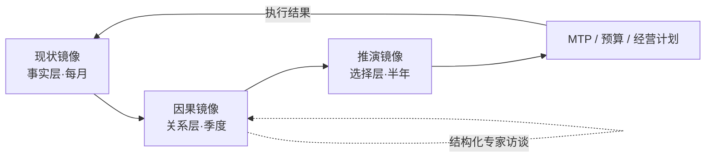
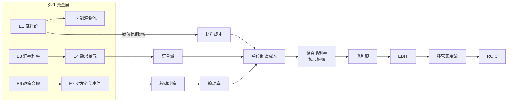
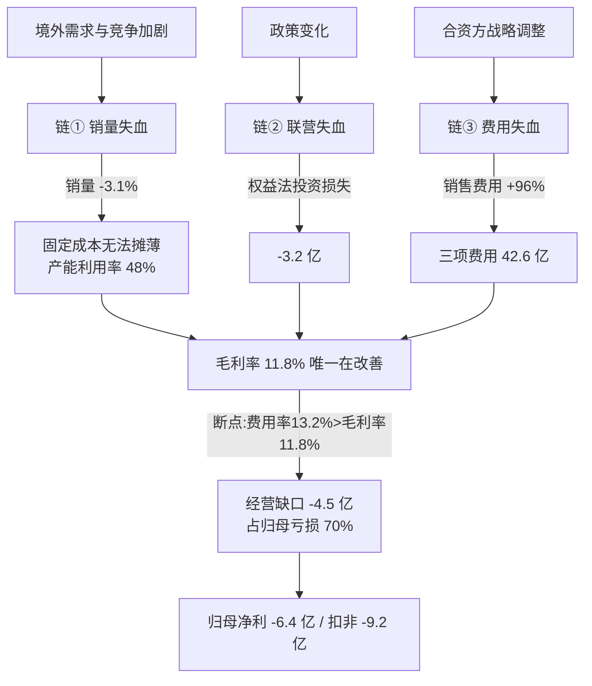
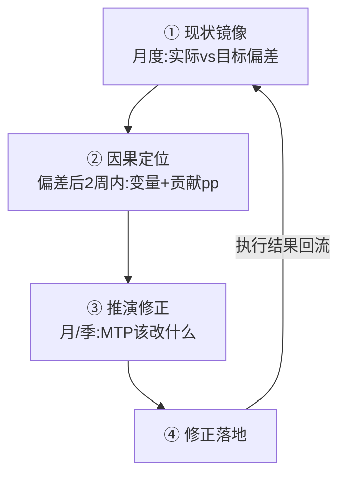
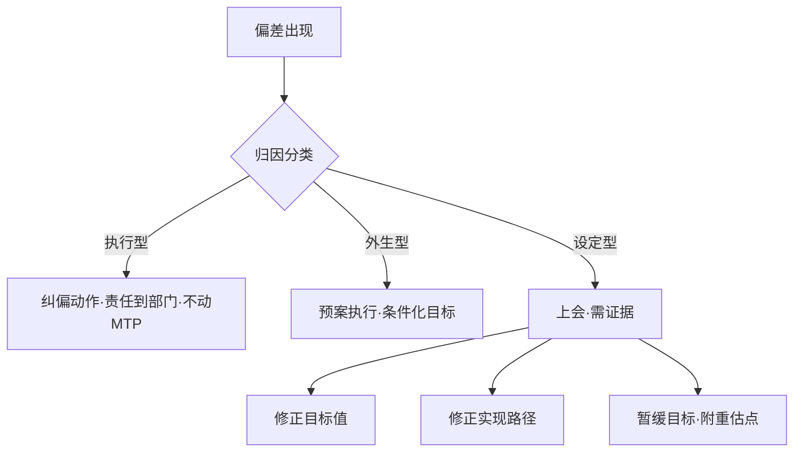

# 3D-MG Mermaid 图模板

> 模型在产出诊断报告时，可直接复制下面任一代码块，填成本公司的变量。
> 两种用法：
> ① **写进 HTML 汇报文档**：在 `templates/report-template.html` 的 `blocks` 里加一个
>    `{ "t": "mermaid", "code": "此处放 Mermaid 源码" }` 的条目，模板已内置 Mermaid 渐进增强渲染；
> ② **生成 PNG**：把源码存成 `.mmd`，跑 `python3 scripts/gen_flowchart.py 图.mmd -o 图.png`。

---

## 模板 1：三层镜像工作流



---

## 模板 2：完整线性因果网络图（主干 · 通用骨架）

> 节点约定：E=外生变量，M=中间变量，D=决策节点，O=经营结果。
> 箭头标注：`符号[弹性量级][时滞]`。例：原材料价 `-->|+0.45 / 2月|` 单位材料成本。



---

## 模板 3：核心痛点因果网络（示例 · 已脱敏）



---

## 模板 4：闭环修正四节拍



---

## 模板 5：偏差三分类 → 处置



---

## 因果链标注规范（写进任何图都适用）

```
变量A --符号[弹性量级][时滞]--> 变量B
例：原材料价格 --+[高0.45][Δt=2月]--> 单位材料成本
    稼动率      --−[高0.42][Δt=1月]--> 单位固定成本
```

- 符号：`+` 同向 / `−` 反向；弹性量级：高 / 中 / 低；时滞 `Δt=`（月）。
- 决策节点用 `D` 标、外生变量用 `E` 标、最终经营结果用 `O` 标。
- 断点（Bottleneck）用红色高亮框单独标出，是报告最关键的一张图。

> **免责声明**：图中数字若为单位示例，仅用于演示方法论，不代表任何具体企业；真实诊断须以公司正式披露为准。
